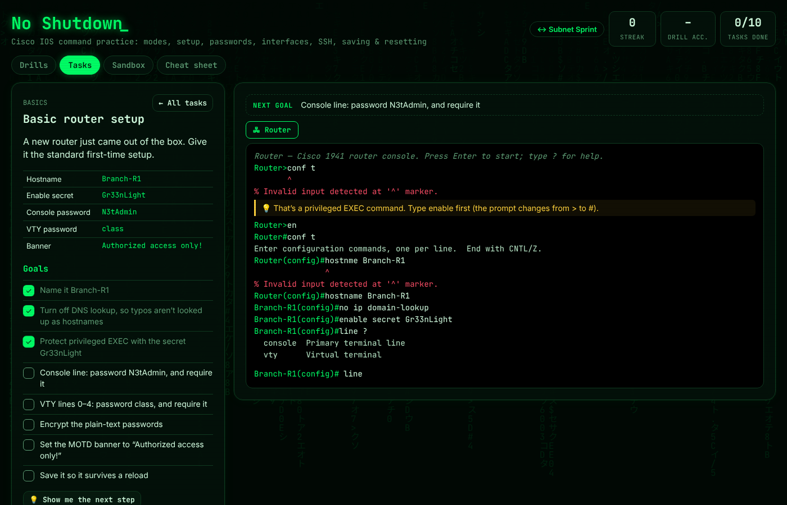
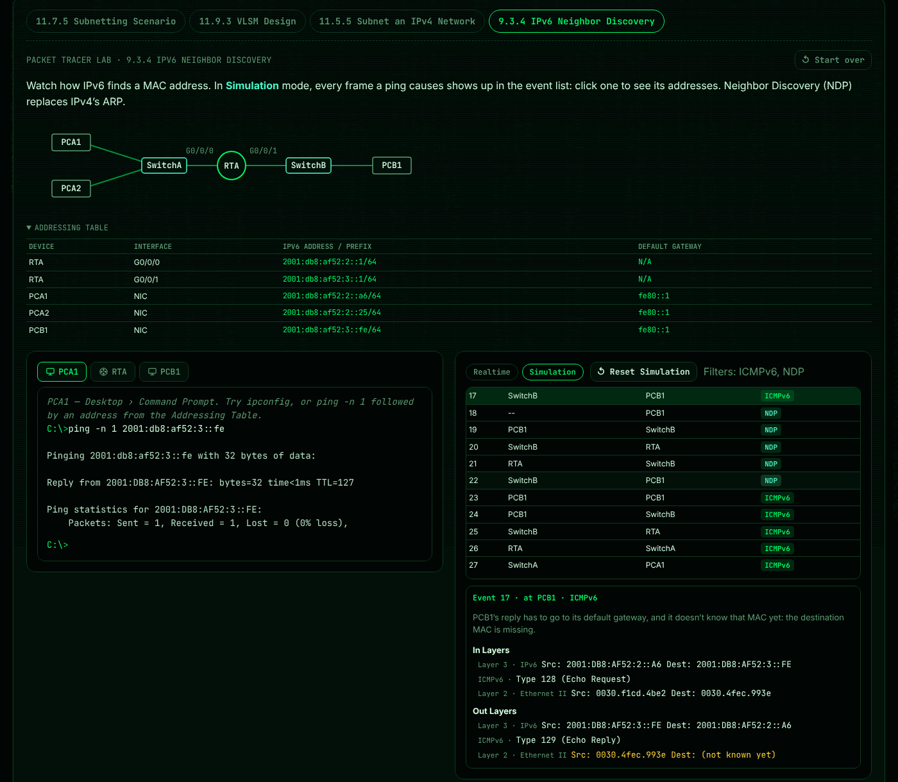
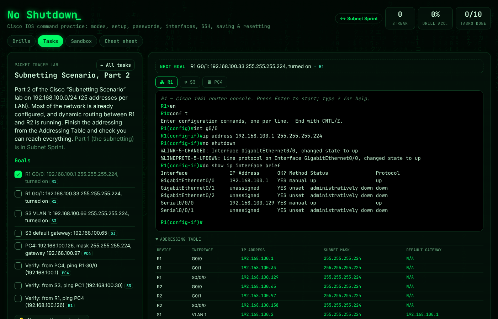

# No Shutdown

## About

Practice Cisco IOS commands in a forest-green console. In **Drills → Practice topic → Missed commands**, a correct first try clears the command from your saved review queue. In **Labs** (the Packet Tracer labs), use **Change lab** for lab and part selection. Expand **Scenario and topology** or **Addressing tables** when you need them. Printing and customization are under **Print, customize or start over**.

**Practice Cisco IOS commands on a simulated router and switch, in your browser.**

Type real commands at a router, switch or PC prompt and get IOS's own error messages, plus a short note that explains what went wrong. It covers what an intro networking course covers: getting around the modes, first-time setup, passwords, interfaces, switch management, SSH, login hardening, and saving, backing up and resetting a device. It also works through Cisco Packet Tracer labs: **11.7.5 Subnetting Scenario**, **11.9.3 VLSM Design and Implementation** and **11.5.5 Subnet an IPv4 Network** (from the subnetting and Addressing Table through configuring the devices), **10.3.4 Connect a Router to a LAN**, and **9.3.4 IPv6 Neighbor Discovery** (a Packet Tracer–style simulation mode with an event list).

### ▶ [Try it here](https://christianjkrantz.github.io/no-shutdown/)


It's built to teach, not to hand out answers. Help comes in steps, from a nudge to the full answer, and the answer is the last step. Every lab and task gets new addresses each time, so its answers won't match anyone else's or the handout's answer key.

Works in any modern browser on desktop, tablet or phone. No install, no account, no tracking. You can also install it as an app, and it works offline after the first visit.



---

## Features

### Layout
The header is one line: the name, and a book button for the cheat sheet. The sections are **Path, Drills, Tasks, Labs and Sandbox**: a row of tabs under the header on a computer, a bar along the bottom of the screen on a phone.

### Learning path (start here)
A fresh visit opens on the **Path**: eight units in the order you'd learn them on a real device. Modes, first-time setup, passwords, interfaces, checking your work, saving and resetting, SSH, then hardening logins. One big button always shows what to do next.

- **Learn, then check.** Each unit opens with a short lesson (a few screens with a sample console) and ends in a quick check you have to get right before the drills start. A wrong pick sends you back to the lesson.
- **Drill to mastery.** A session is 5–6 drills from that unit's topic, with new values every time. A drill you miss comes back at the end.
- **Signal bars.** 80% right on the first try (no hint, no answer shown) adds a bar (up to five) and unlocks the next unit. Each bar waits longer before the unit is due for review: 1, 3, 7, 16, then 35 days.
- **Checkpoints.** Once a unit's drills are done, its checkpoint task puts the commands together on a simulated device (Basic router setup after Passwords, Router interfaces and Switch management after Interfaces, and so on). The path ticks it off when the task is finished.
- On a phone, a lesson or session hides the header and tabs so the command box sits near the top of the screen. The Drills tab is still free practice on any topic.

### Drills
One job at a time: the drill names a task ("Give this interface the address 192.168.101.1 255.255.255.0") and shows the prompt you're at, and you type the command.

- **Any abbreviation IOS would accept counts.** `int g0/0`, `no shut`, `conf t` and `copy run start` are checked by the same parser the console uses, not compared to a fixed answer.
- **Wrong answers get the real error**: the `^` marker under the bad word, `% Incomplete command`, or `% Ambiguous command`, plus a note when it's a common mistake (a `/24` instead of a dotted mask, `ip default gateway` without the dash, a config command typed at `R1#`).
- **A real command that does the wrong thing** gets told what it would do instead.
- 45 drills in 8 topics: Modes, Basic setup, Passwords, Interfaces, SSH, Security, Save & reset, Verify. Pick a topic or mix them all. Values are random every time, and missed drills come back a few questions later.
- **Hint** first shows the command's shape with the values left as placeholders (`ip address <address> <mask>`); only then does it become **Show answer**. Either one ends the streak, scores nothing, and brings the drill back a few questions later.
- Streak, best streak and accuracy are shown at the top of each drill and saved in your browser. The Tasks tab shows how many tasks you've finished.


### Tasks
Thirteen multi-step configurations, each with a checklist of goals that tick off as you meet them. The goals check the device's actual state, so any order and any valid spelling works.

| Task | What you configure |
|---|---|
| **Find your way around the modes** | `enable`, `configure terminal`, `interface`, `exit`, `end`, `disable` |
| **Basic router setup** | Hostname, `no ip domain-lookup`, enable secret, console and VTY passwords, `service password-encryption`, MOTD banner, save |
| **Switch management** | `interface vlan 1` address, `no shutdown`, `ip default-gateway`, VTY 0 15, then ping it from a PC on another LAN |
| **Router interfaces** | Descriptions, addresses and `no shutdown` on G0/0, G0/1 and S0/0/0, `show ip interface brief`, pings |
| **Set up SSH** | Domain name, RSA keys, SSH version 2, local user, `transport input ssh`, `login local`, then SSH in from a PC |
| **Harden logins** | `security passwords min-length`, `login block-for`, `exec-timeout`, password encryption |
| **Reset a switch** | `erase startup-config`, `delete vlan.dat`, `reload` without saving |
| **Fix the configuration register** | `show version`, `config-register 0x2102` |
| **Back up and restore** | `copy running-config flash:`, `show flash`, `copy flash: running-config` |
| **Subnetting Scenario, Part 2** | Part 2 of the Cisco Packet Tracer lab 11.7.5: R1's LAN interfaces, S3's management address and gateway, PC4's settings, then the verification pings |
| **VLSM Design, Part 3** | Part 3 of the Cisco Packet Tracer lab 11.9.3: the same jobs, but every subnet has its own mask, so each interface has to match the Addressing Table |
| **Subnet an IPv4 Network, Part 2** | Part 2 of the Cisco Packet Tracer lab 11.5.5: CustomerRouter's secret, console password, hostname and LAN interfaces, save, both switches' management addresses, both PCs, then the pings |
| **Connect a Router to a LAN** | The Cisco Packet Tracer lab 10.3.4: log in at the console, read R1 and R2 with `show interfaces`, `show ip interface brief` and `show ip route`, address and describe the four LAN interfaces, save, and answer the handout's questions, each checked against the routers as they are |

- Every task has new values each time (hostnames, passwords, networks), shown in a "given" table and an addressing table.
- **Help with the next step** goes in three levels for the next unmet goal, starting from the prompt you're at now: first what to do in plain words (which mode, what the command is for), then the syntax with `<placeholders>`, then the exact commands. Finishing without help earns three stars; each level used costs a little.
- Tasks from a lab handout also list its questions under the goals, checked against the devices as they are right now; the task is done when the goals and the questions are. A question teaches before it tells: **Hint**, or a wrong answer, opens *where to look*, then the idea behind it. The answer only unlocks after two wrong tries (or every hint and a try), comes with the reasoning, and still has to be typed in.
- Tasks with several devices have a tab for each one. PCs have an **IP Configuration** form and a **Command Prompt** (`ping`, `ipconfig`, `ssh -l`), like Packet Tracer's Desktop tab.

### Packet Tracer labs
Pick a lab at the top of the tab. The three subnetting labs run one question at a time, in the handout's order, and finish with the configuration task on the same network. 11.7.5 and 11.9.3 share a two-router topology (R1 and R2, two LANs each, joined by a serial link).

**11.7.5 Subnetting Scenario.** One mask for every subnet.
- **Part 1, Step 1:** how many subnets the topology needs, how many bits to borrow, the subnets and hosts that makes, each subnet's binary value, the new mask, and the full subnet table.
- **Steps 2–3:** assign the subnets to the LANs and the R1–R2 link, then fill in the Addressing Table by its rules.
- **Part 2:** configure R1's LAN interfaces, S3's management address and gateway, and PC4's settings, then ping.

**11.9.3 VLSM Design and Implementation.** Each LAN gets its own subnet size.
- **Part 1:** how many subnets are needed, then for each LAN the smallest mask that fits its hosts and how many usable addresses it gives, and a /30 for the R1–R2 link.
- **Part 2:** the subnet table, biggest first (description, hosts, network/CIDR, first usable, broadcast), then the Addressing Table, where each interface takes its own subnet's mask.
- **Part 3:** the same configuration jobs, with a different mask on each interface.

**11.5.5 Subnet an IPv4 Network.** One router, two LANs, and a /24 to split.
- **Part 1:** the hosts each LAN needs, the subnets needed (the two LANs plus the spares the handout asks for), then the one mask that meets both requirements, in binary and dotted decimal, the subnet table, and the Addressing Table.
- **Part 2:** CustomerRouter's enable secret, console password and hostname, its two LAN interfaces, save, both switches' management addresses and gateways, both PCs, then the pings.

**9.3.4 IPv6 Neighbor Discovery.** PCA1 and PCA2 on one LAN, RTA, and PCB1 on the other. There's nothing to configure; you watch.
- **Simulation mode**, like Packet Tracer's: ping from PCA1's command prompt and every hop shows up in the event list (NDP and ICMPv6). Click an event to see its In and Out Layers: the IPv6 and Ethernet addresses and the ICMPv6 type.
- Neighbor Discovery runs the way the lab shows it: a Neighbor Solicitation (135) to the solicited-node group `ff02::1:ffXX:XXXX` and its `3333.ffXX.XXXX` MAC, flooded by the switch and dropped by everyone but the owner, then a Neighbor Advertisement (136) back. The second ping needs none of it. A ping to the other LAN finds the gateway (`fe80::1`) first, then RTA does its own Neighbor Discovery on the far LAN, and PCB1's reply waits on one more.
- RTA's console has `show ipv6 neighbors`, `clear ipv6 neighbors`, `show ipv6 interface brief` and `ping`, and its neighbor table holds exactly what the pings taught it.
- The handout's questions sit under the simulation, checked against what actually happened, with the same hint-first help. Each run uses new prefixes, host addresses and MACs, and the finish line counts how many you answered on your own.

The Addressing Table rules are the same in the subnetting labs: routers take the first usable address on their LANs, R1 the first and R2 the last on the WAN link, switches the second usable, and PCs the last usable.

Feedback names the mistake without giving the answer away. It catches forgetting the WAN link, borrowing too many bits, leaving off the − 2, writing the subnet number instead of its binary value, picking a mask too small or bigger than needed, a /29 for a two-router link, a network without its /prefix, not going biggest first, another LAN's mask on an interface, putting a device on the wrong subnet, and pointing a PC's gateway at the switch. **Hint** walks through the step a line at a time; a wrong answer opens the first hint by itself. **Show the answer** unlocks only after two wrong tries (or every hint and a try). It shows the answer next to the full worked steps, and you type it in yourself. At the end, the lab lists the questions you needed the answer for, so you know what to practice on a new network. The tables fill in beside the questions as you go.

- Practice a whole lab or one part (the earlier parts' answers are given).
- **Your own lab** takes any /24. For 11.7.5, set the addresses each LAN needs and 1–3 LANs per router. For 11.9.3, set each of the four LANs' host counts. The address bar then links to that exact lab.
- **Print** gives the lab in the handout's format, with an optional answer key.
- The configuration task links back to the lab, still on the same network.

Lab links take the network in the address bar:

```
https://christianjkrantz.github.io/no-shutdown/?lab=192.168.100.0&hosts=25&r1=2&r2=2                  11.7.5, Part 1
https://christianjkrantz.github.io/no-shutdown/?task=scenario&lab=192.168.100.0&hosts=25&r1=2&r2=2    11.7.5, Part 2
https://christianjkrantz.github.io/no-shutdown/?vlsm=192.168.72.0&hosts=50,25,12,6                    11.9.3, Parts 1–2
https://christianjkrantz.github.io/no-shutdown/?task=vlsm-scenario&vlsm=192.168.72.0&hosts=50,25,12,6 11.9.3, Part 3
```

For 11.7.5, `lab` is the /24 network, `hosts` the addresses each LAN needs, and `r1`/`r2` how many LANs each router has. For 11.9.3, `vlsm` is the /24 and `hosts` the four LANs' host counts in order (R1 G0/0, R1 G0/1, R2 G0/0, R2 G0/1). For 11.5.5, `subnet` is the /24, `hosts` the two LANs' host counts and `spare` the extra subnets (`?subnet=192.168.0.0&hosts=50,40&spare=2`, and `?task=subnet-ipv4&…` for Part 2). `?lab=nd` opens 9.3.4. `?task=connect-router` opens 10.3.4 on new addresses, and the link it then shows (`&a=…&b=…&c=…&w=…`) reopens those same addresses. Values that don't make a valid lab are ignored and you get a random one.






### The console
- **`?` help** at any point: `?` alone, `sh ?` for what can follow, `co?` for words that start with "co".
- **Tab** completes a word when it's unique; **↑ / ↓** go through your history; **Ctrl+Z** goes back to privileged EXEC.
- `do` runs EXEC commands from config mode, and global commands work from interface and line mode, like real IOS.
- `show running-config` (with `| include`, `| exclude`, `| begin`, `| section`), `show startup-config`, `show ip interface brief`, `show interfaces`, `show ip route`, `show version`, `show flash`, and more.
- IPv6: `ipv6 unicast-routing`, `show ipv6 interface brief`, `show ipv6 neighbors`, `clear ipv6 neighbors`, and `ping` to an IPv6 address; PCs take `ping -n` and IPv6 addresses.
- Passwords behave the way they do on the device: `enable` and the console ask for them, `service password-encryption` turns them into type 7, `enable secret` shows as type 5.
- Saving, `erase startup-config`, `delete vlan.dat` and `reload` (with "System configuration has been modified. Save?") work, and so do the `[confirm]` prompts.
- On a phone, helper keys sit under the console for Tab, ?, ↑, ↓ and Ctrl+Z.

### Sandbox
A factory-fresh router, switch and PC cabled together, with no goals and no score.

### Cheat sheet
Open it from the book button at the top right of the page.
The commands from the drills and tasks in one page, grouped by topic, with the prompt each one is typed at.

<p align="center"></p>

---

## Limits

This is a practice tool, not an emulator. It covers the commands from an intro networking course (Cisco Networking Academy ITN / CCNA 1 level), not all of IOS: no VLANs beyond VLAN 1, no ACLs, and no routing protocols to configure (10.3.4's routers come with their OSPF routes already learned). Pings are worked out from the addresses, masks, gateways and which interfaces are up, not by sending packets.

## Running it locally

It's a static site with no build step. Open `index.html`, or serve the folder:

```
python3 -m http.server
```

## Tests

```
node tests/test_ios.js        # the IOS simulator: modes, errors, help, passwords, saving, ping, SSH (82 checks)
node tests/solve_tasks.js     # solves every task 25 times with fresh values using its own Show me steps,
                              # and checks every drill answer and shortcut is accepted
python3 tests/test_path.py    # the learning path: lesson gate, first-try scoring, unlocks, checkpoints, every unit, phones
python3 tests/test_ui.py      # browser tests with Playwright: drills, completing all thirteen tasks by typing,
                              # lab links and bad values, phone layout, and typed HTML staying text
python3 tests/test_lab.py     # both Packet Tracer labs: the handout answers, 300 random networks each, feedback
                              # for common mistakes, hints, parts, your own lab, printing, phones, lab ↔ configuration
python3 tests/test_more_labs.py  # 11.5.5 (every answer, then Part 2), 10.3.4's questions checked live, and 9.3.4:
                              # the event list, solicited-node addresses, neighbor tables, every question, phones
```

The browser tests need `pip install playwright` and `playwright install chromium`.

## Files

| File | What it is |
|---|---|
| `index.html` | The page and its styles |
| `ios.js` | The IOS simulator: command grammar, modes, errors, help, device state, ping and SSH |
| `content.js` | Drills, tasks and the cheat sheet |
| `path-content.js` | The learning path's units: lessons, quick checks and checkpoint tasks |
| `lab.js` | The Packet Tracer labs' subnetting parts: the networks, questions, feedback, hints and printouts |
| `nd.js` | The 9.3.4 network and its IPv6 Neighbor Discovery, recorded as simulation events |
| `app.js` | The interface: console, PC panel, drills, tasks, the lab, sandbox |
| `sw.js`, `manifest.webmanifest` | Offline support and app install |

## License

MIT. See [LICENSE](LICENSE).
