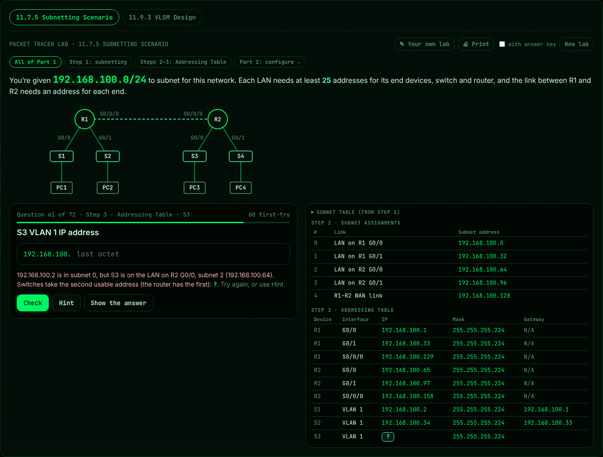
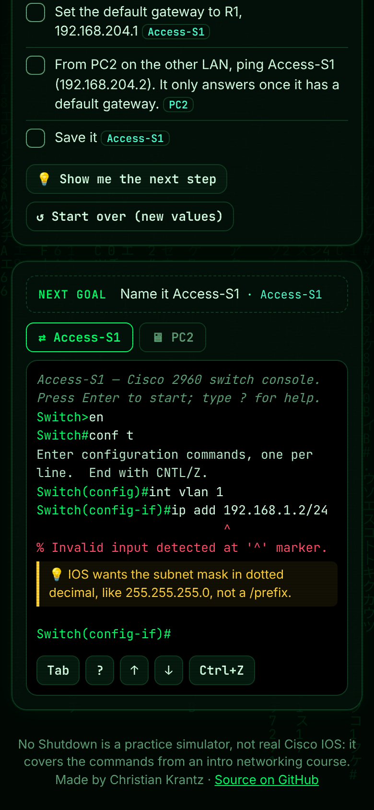

# No Shutdown

**Practice Cisco IOS commands on a simulated router and switch, in your browser.**

Type real commands at a router, switch or PC prompt and get IOS's own error messages, plus a short note that explains what went wrong. It covers what an intro networking course covers: getting around the modes, first-time setup, passwords, interfaces, switch management, SSH, login hardening, and saving, backing up and resetting a device. It also has two whole Cisco Packet Tracer labs, from the subnetting and Addressing Table through configuring the devices: **11.7.5 Subnetting Scenario** and **11.9.3 VLSM Design and Implementation**.

### ▶ [Try it here](https://christianjkrantz.github.io/no-shutdown/)

Sister site: **[Subnet Sprint](https://christianjkrantz.github.io/subnet-sprint/)** for subnetting and IPv4 addressing practice.

Works in any modern browser on desktop, tablet or phone. No install, no account, no tracking. You can also install it as an app, and it works offline after the first visit.


---

## Features

### Drills
One job at a time: the drill names a task ("Give this interface the address 192.168.101.1 255.255.255.0") and shows the prompt you're at, and you type the command.

- **Any abbreviation IOS would accept counts.** `int g0/0`, `no shut`, `conf t` and `copy run start` are checked by the same parser the console uses, not compared to a fixed answer.
- **Wrong answers get the real error**: the `^` marker under the bad word, `% Incomplete command`, or `% Ambiguous command`, plus a note when it's a common mistake (a `/24` instead of a dotted mask, `ip default gateway` without the dash, a config command typed at `R1#`).
- **A real command that does the wrong thing** gets told what it would do instead.
- 45 drills in 8 topics: Modes, Basic setup, Passwords, Interfaces, SSH, Security, Save & reset, Verify. Pick a topic or mix them all. Values are random every time, and missed drills come back a few questions later.
- Streak, best streak and accuracy are saved in your browser.


### Tasks
Eleven multi-step configurations, each with a checklist of goals that tick off as you meet them. The goals check the device's actual state, so any order and any valid spelling works.

| Task | What you configure |
|---|---|
| **Find your way around the modes** | `enable`, `configure terminal`, `interface`, `exit`, `end`, `disable` |
| **Basic router setup** | Hostname, `no ip domain-lookup`, enable secret, console and VTY passwords, `service password-encryption`, MOTD banner, save |
| **Switch management** | `interface vlan 1` address, `no shutdown`, `ip default-gateway`, VTY 0 15, then ping it from a PC on another LAN |
| **Router interfaces** | Descriptions, addresses and `no shutdown` on G0/0, G0/1 and S0/0/0, `show ip interface brief`, pings |
| **Set up SSH** | Domain name, RSA keys, SSH version 2, local user, `transport input ssh`, `login local`, then SSH in from a PC |
| **Harden logins** | `security passwords min-length`, `login block-for`, `exec-timeout`, password encryption |
| **Reset a switch** | `erase startup-config`, `delete vlan.dat`, `reload` without saving |
| **Fix the configuration register** | `show version`, `config-register 0x2102` |
| **Back up and restore** | `copy running-config flash:`, `show flash`, `copy flash: running-config` |
| **Subnetting Scenario, Part 2** | Part 2 of the Cisco Packet Tracer lab 11.7.5: R1's LAN interfaces, S3's management address and gateway, PC4's settings, then the verification pings |
| **VLSM Design, Part 3** | Part 3 of the Cisco Packet Tracer lab 11.9.3: the same jobs, but every subnet has its own mask, so each interface has to match the Addressing Table |

- Every task has new values each time (hostnames, passwords, networks), shown in a "given" table and an addressing table.
- **Show me the next step** lists the commands for the next unmet goal, from the prompt you're at now. Finishing without it earns three stars; each use costs some.
- Tasks with several devices have a tab for each one. PCs have an **IP Configuration** form and a **Command Prompt** (`ping`, `ipconfig`, `ssh -l`), like Packet Tracer's Desktop tab.

### Packet Tracer labs
Two Cisco Packet Tracer labs on the same two-router topology: R1 and R2, two LANs each, joined by a serial link. Pick one at the top of the tab. Each runs one question at a time, in the handout's order, and finishes with the configuration task on the same network.

**11.7.5 Subnetting Scenario.** One mask for every subnet.
- **Part 1, Step 1:** how many subnets the topology needs, how many bits to borrow, the subnets and hosts that makes, each subnet's binary value, the new mask, and the full subnet table.
- **Steps 2–3:** assign the subnets to the LANs and the R1–R2 link, then fill in the Addressing Table by its rules.
- **Part 2:** configure R1's LAN interfaces, S3's management address and gateway, and PC4's settings, then ping.

**11.9.3 VLSM Design and Implementation.** Each LAN gets its own subnet size.
- **Part 1:** how many subnets are needed, then for each LAN the smallest mask that fits its hosts and how many usable addresses it gives, and a /30 for the R1–R2 link.
- **Part 2:** the subnet table, biggest first (description, hosts, network/CIDR, first usable, broadcast), then the Addressing Table, where each interface takes its own subnet's mask.
- **Part 3:** the same configuration jobs, with a different mask on each interface.

The Addressing Table rules are the same in both: routers take the first usable address on their LANs, R1 the first and R2 the last on the WAN link, switches the second usable, and PCs the last usable.

Feedback names the mistake without giving the answer away. It catches forgetting the WAN link, borrowing too many bits, leaving off the − 2, writing the subnet number instead of its binary value, picking a mask too small or bigger than needed, a /29 for a two-router link, a network without its /prefix, not going biggest first, another LAN's mask on an interface, putting a device on the wrong subnet, and pointing a PC's gateway at the switch. **Hint** walks through the step a line at a time, and **Show the answer** fills it in. The tables fill in beside the questions as you go.

- Practice a whole lab or one part (the earlier parts' answers are given).
- **Your own lab** takes any /24. For 11.7.5, set the addresses each LAN needs and 1–3 LANs per router. For 11.9.3, set each of the four LANs' host counts. The address bar then links to that exact lab.
- **Print** gives the lab in the handout's format, with an optional answer key.
- The configuration task links back to the lab, still on the same network.

Lab links take the network in the address bar:

```
https://christianjkrantz.github.io/no-shutdown/?lab=192.168.100.0&hosts=25&r1=2&r2=2                  11.7.5, Part 1
https://christianjkrantz.github.io/no-shutdown/?task=scenario&lab=192.168.100.0&hosts=25&r1=2&r2=2    11.7.5, Part 2
https://christianjkrantz.github.io/no-shutdown/?vlsm=192.168.72.0&hosts=50,25,12,6                    11.9.3, Parts 1–2
https://christianjkrantz.github.io/no-shutdown/?task=vlsm-scenario&vlsm=192.168.72.0&hosts=50,25,12,6 11.9.3, Part 3
```

For 11.7.5, `lab` is the /24 network, `hosts` the addresses each LAN needs, and `r1`/`r2` how many LANs each router has. For 11.9.3, `vlsm` is the /24 and `hosts` the four LANs' host counts in order (R1 G0/0, R1 G0/1, R2 G0/0, R2 G0/1). Values that don't make a valid lab are ignored and you get a random one. Old Packet Tracer lab links from Subnet Sprint forward here.




### The console
- **`?` help** at any point: `?` alone, `sh ?` for what can follow, `co?` for words that start with "co".
- **Tab** completes a word when it's unique; **↑ / ↓** go through your history; **Ctrl+Z** goes back to privileged EXEC.
- `do` runs EXEC commands from config mode, and global commands work from interface and line mode, like real IOS.
- `show running-config` (with `| include`, `| exclude`, `| begin`, `| section`), `show startup-config`, `show ip interface brief`, `show version`, `show flash`, and more.
- Passwords behave the way they do on the device: `enable` and the console ask for them, `service password-encryption` turns them into type 7, `enable secret` shows as type 5.
- Saving, `erase startup-config`, `delete vlan.dat` and `reload` (with "System configuration has been modified. Save?") work, and so do the `[confirm]` prompts.
- On a phone, helper keys sit under the console for Tab, ?, ↑, ↓ and Ctrl+Z.

### Sandbox
A factory-fresh router, switch and PC cabled together, with no goals and no score.

### Cheat sheet
The commands from the drills and tasks in one page, grouped by topic, with the prompt each one is typed at.

<p align="center"></p>

---

## Limits

This is a practice tool, not an emulator. It covers the commands from an intro networking course (Cisco Networking Academy ITN / CCNA 1 level), not all of IOS: no VLANs beyond VLAN 1, no routing protocols, no ACLs. Pings are worked out from the addresses, masks, gateways and which interfaces are up, not by sending packets.

## Running it locally

It's a static site with no build step. Open `index.html`, or serve the folder:

```
python3 -m http.server
```

## Tests

```
node tests/test_ios.js        # the IOS simulator: modes, errors, help, passwords, saving, ping, SSH (82 checks)
node tests/solve_tasks.js     # solves every task 25 times with fresh values using its own Show me steps,
                              # and checks every drill answer and shortcut is accepted
python3 tests/test_ui.py      # browser tests with Playwright: drills, completing all eleven tasks by typing,
                              # lab links and bad values, phone layout, and typed HTML staying text
python3 tests/test_lab.py     # both Packet Tracer labs: the handout answers, 300 random networks each, feedback
                              # for common mistakes, hints, parts, your own lab, printing, phones, lab ↔ configuration
```

The browser tests need `pip install playwright` and `playwright install chromium`.

## Files

| File | What it is |
|---|---|
| `index.html` | The page and its styles |
| `ios.js` | The IOS simulator: command grammar, modes, errors, help, device state, ping and SSH |
| `content.js` | Drills, tasks and the cheat sheet |
| `lab.js` | The Packet Tracer labs' subnetting parts: the networks, questions, feedback, hints and printouts |
| `app.js` | The interface: console, PC panel, drills, tasks, the lab, sandbox |
| `sw.js`, `manifest.webmanifest` | Offline support and app install |

## License

MIT. See [LICENSE](LICENSE).
