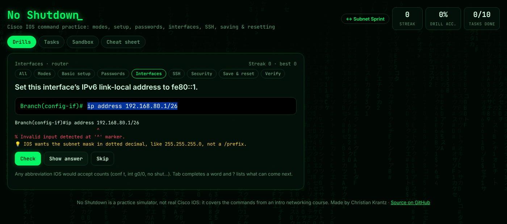

# No Shutdown

**Practice Cisco IOS commands on a simulated router and switch, in your browser.**

Type real commands at a router, switch or PC prompt and get IOS's own error messages, plus a short note that explains what went wrong. It covers what an intro networking course covers: getting around the modes, first-time setup, passwords, interfaces, switch management, SSH, login hardening, and saving, backing up and resetting a device.

### ▶ [Try it here](https://christianjkrantz.github.io/no-shutdown/)

Sister site: **[Subnet Sprint](https://christianjkrantz.github.io/subnet-sprint/)** for subnetting and IPv4 addressing practice.

Works in any modern browser on desktop, tablet or phone. No install, no account, no tracking. You can also install it as an app, and it works offline after the first visit.


---

## Features

### Drills
One job at a time: the drill names a task ("Give this interface the address 192.168.101.1 255.255.255.0") and shows the prompt you're at, and you type the command.

- **Any abbreviation IOS would accept counts.** `int g0/0`, `no shut`, `conf t` and `copy run start` are checked by the same parser the console uses, not compared to a fixed answer.
- **Wrong answers get the real error**: the `^` marker under the bad word, `% Incomplete command`, or `% Ambiguous command`, plus a note when it's a common mistake (a `/24` instead of a dotted mask, `ip default gateway` without the dash, a config command typed at `R1#`).
- **A real command that does the wrong thing** gets told what it would do instead.
- 45 drills in 8 topics: Modes, Basic setup, Passwords, Interfaces, SSH, Security, Save & reset, Verify. Pick a topic or mix them all. Values are random every time, and missed drills come back a few questions later.
- Streak, best streak and accuracy are saved in your browser.



### Tasks
Ten multi-step configurations, each with a checklist of goals that tick off as you meet them. The goals check the device's actual state, so any order and any valid spelling works.

| Task | What you configure |
|---|---|
| **Find your way around the modes** | `enable`, `configure terminal`, `interface`, `exit`, `end`, `disable` |
| **Basic router setup** | Hostname, `no ip domain-lookup`, enable secret, console and VTY passwords, `service password-encryption`, MOTD banner, save |
| **Switch management** | `interface vlan 1` address, `no shutdown`, `ip default-gateway`, VTY 0 15, then ping it from a PC on another LAN |
| **Router interfaces** | Descriptions, addresses and `no shutdown` on G0/0, G0/1 and S0/0/0, `show ip interface brief`, pings |
| **Set up SSH** | Domain name, RSA keys, SSH version 2, local user, `transport input ssh`, `login local`, then SSH in from a PC |
| **Harden logins** | `security passwords min-length`, `login block-for`, `exec-timeout`, password encryption |
| **Reset a switch** | `erase startup-config`, `delete vlan.dat`, `reload` without saving |
| **Fix the configuration register** | `show version`, `config-register 0x2102` |
| **Back up and restore** | `copy running-config flash:`, `show flash`, `copy flash: running-config` |
| **Subnetting Scenario, Part 2** | Part 2 of the Cisco Packet Tracer lab 11.7.5: R1's LAN interfaces, S3's management address and gateway, PC4's settings, then the verification pings |

- Every task has new values each time (hostnames, passwords, networks), shown in a "given" table and an addressing table.
- **Show me the next step** lists the commands for the next unmet goal, from the prompt you're at now. Finishing without it earns three stars; each use costs some.
- Tasks with several devices have a tab for each one. PCs have an **IP Configuration** form and a **Command Prompt** (`ping`, `ipconfig`, `ssh -l`), like Packet Tracer's Desktop tab.

#### Coming from Subnet Sprint
Subnet Sprint's Packet Tracer lab mode does Part 1 of the Subnetting Scenario (the subnetting and the Addressing Table). Its "Part 2" link opens the matching task here with the same network, so the addresses carry over:

```
https://christianjkrantz.github.io/no-shutdown/?task=scenario&lab=192.168.100.0&hosts=25&r1=2&r2=2
```

`lab` is the /24 network, `hosts` the addresses each LAN needs, and `r1`/`r2` how many LANs each router has. Values that don't make a valid lab are ignored and the task uses random ones.


### The console
- **`?` help** at any point: `?` alone, `sh ?` for what can follow, `co?` for words that start with "co".
- **Tab** completes a word when it's unique; **↑ / ↓** go through your history; **Ctrl+Z** goes back to privileged EXEC.
- `do` runs EXEC commands from config mode, and global commands work from interface and line mode, like real IOS.
- `show running-config` (with `| include`, `| exclude`, `| begin`, `| section`), `show startup-config`, `show ip interface brief`, `show version`, `show flash`, and more.
- Passwords behave the way they do on the device: `enable` and the console ask for them, `service password-encryption` turns them into type 7, `enable secret` shows as type 5.
- Saving, `erase startup-config`, `delete vlan.dat` and `reload` (with "System configuration has been modified. Save?") work, and so do the `[confirm]` prompts.
- On a phone, helper keys sit under the console for Tab, ?, ↑, ↓ and Ctrl+Z.

### Sandbox
A factory-fresh router, switch and PC cabled together, with no goals and no score.

### Cheat sheet
The commands from the drills and tasks in one page, grouped by topic, with the prompt each one is typed at.

<p align="center"></p>

---

## Limits

This is a practice tool, not an emulator. It covers the commands from an intro networking course (Cisco Networking Academy ITN / CCNA 1 level), not all of IOS: no VLANs beyond VLAN 1, no routing protocols, no ACLs. Pings are worked out from the addresses, masks, gateways and which interfaces are up, not by sending packets.

## Running it locally

It's a static site with no build step. Open `index.html`, or serve the folder:

```
python3 -m http.server
```

## Tests

```
node tests/test_ios.js        # the IOS simulator: modes, errors, help, passwords, saving, ping, SSH (82 checks)
node tests/solve_tasks.js     # solves every task 25 times with fresh values using its own Show me steps,
                              # and checks every drill answer and shortcut is accepted
python3 tests/test_ui.py      # browser tests with Playwright: drills, completing all ten tasks by typing,
                              # the Subnet Sprint link and bad values, phone layout, and typed HTML staying text
```

`test_ui.py` needs `pip install playwright` and `playwright install chromium`.

## Files

| File | What it is |
|---|---|
| `index.html` | The page and its styles |
| `ios.js` | The IOS simulator: command grammar, modes, errors, help, device state, ping and SSH |
| `content.js` | Drills, tasks and the cheat sheet |
| `app.js` | The interface: console, PC panel, drills, tasks, sandbox |
| `sw.js`, `manifest.webmanifest` | Offline support and app install |

## License

MIT. See [LICENSE](LICENSE).
